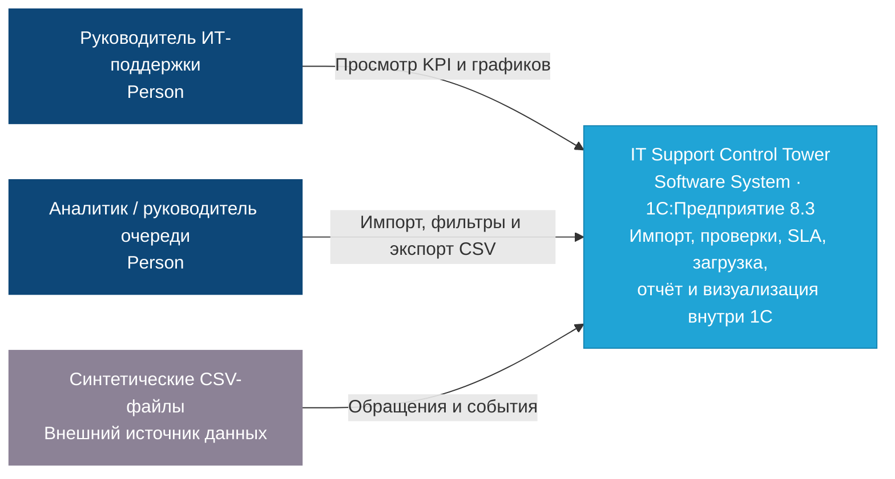

# IT Support Control Tower — команда 4

Учебный проект по кейсу № 19 «Дашборд производительности ИТ-подразделения» на платформе **1С:Предприятие 8.3**.

Система предназначена для анализа соблюдения SLA и распределения нагрузки внутренней ИТ-поддержки. Руководитель сможет находить проблемные очереди и исполнителей, сравнивать показатели и выгружать результаты на основе синтетических данных об обращениях.

**Текущий этап: проектирование.** В репозитории опубликованы пользовательские сценарии и диаграммы Use Case. Конфигурация 1С, демонстрационные CSV и готовый MVP пока не опубликованы; возможности ниже описывают целевой результат проекта.

## Пользователи

| Роль | Основные задачи |
|---|---|
| Руководитель ИТ-поддержки | Контроль SLA, анализ нагрузки, выявление проблемных зон |
| Руководитель очереди | Анализ показателей очереди и распределения обращений |
| Аналитик | Импорт и проверка данных, подготовка отчётов, экспорт результатов |
| Администратор 1С | Первоначальная настройка справочников и прав; точный состав полномочий предстоит согласовать |

Система поддерживает управленческий анализ. Решения о распределении работы принимает человек.

## Объём MVP

### Must have — обязательные возможности

- Набор не менее **300 синтетических обращений** первой и второй линий поддержки.
- Импорт обращений и событий из локальных CSV-файлов.
- Проверка структуры, ссылок и хронологии данных; не менее пяти типов валидаций.
- Повторный импорт одинаковых данных без создания дубликатов.
- Расчёт времени реакции и решения, определение нарушений SLA отдельно для каждого показателя.
- Анализ активных обращений по очередям и исполнителям.
- Отчёт **«SLA и загрузка»**, диаграмма SLA по приоритетам и визуализация нагрузки внутри 1С.
- Фильтры по периоду, очереди, исполнителю и приоритету.
- Экспорт агрегированных результатов в CSV.
- Документация формул и правил обработки данных, контрольные примеры и сценарий демонстрации.

### Should have — желательные улучшения

- Медианное время реакции и решения дополнительно к средним значениям.
- Удобная детализация показателей по приоритетам.
- Наглядное выделение очередей и исполнителей с высокой нагрузкой.

### Could have — при наличии времени

- Пояснения к выявленным отклонениям.
- Дополнительные аналитические срезы и расширенная визуализация динамики.

### Вне MVP

- Подключение к реальным Service Desk-системам, включая Jira и OTRS.
- Использование производственных данных и реальных персональных данных.
- Автоматическое создание, изменение, маршрутизация и переназначение обращений.
- ML-прогнозирование, полноценная система управления персоналом и мобильное приложение.
- Промышленное внедрение и сопровождение.

Приоритеты отдельных расширений в черновике сценариев требуют сверки с итоговой MoSCoW-матрицей. Ввод событий операторами, оценка рисков открытых обращений и расширенное управление ролями не считаются утверждёнными обязательными функциями.

## Архитектура и граница системы

**Базовый вариант:** импорт, хранение, проверки, расчёты, отчёт и визуализация реализуются внутри решения на 1С:Предприятие 8.3. Источник — локальные синтетические CSV-файлы. Отдельный API или внешний аналитический сервис для базового MVP не требуется.

Ниже приведён **C4 System Context, уровень C1**: вся система показана одним блоком без детализации внутренних компонентов.



**Открытое решение по интерфейсу:** команда может рассмотреть отдельное аналитическое приложение через CSV-снимок **только после согласования с преподавателем**. До согласования основой проекта остаётся визуализация внутри 1С. При одобрении альтернативы необходимо обновить архитектуру, правила обмена и критерии приёмки.

## Данные и расчёты

### Основные сущности

| Сущность | Содержание |
|---|---|
| `tickets` | Идентификатор обращения, время создания, приоритет, очередь, исполнитель, время закрытия |
| `events` | Идентификатор обращения, тип события и временная метка |
| `sla_targets` | Приоритет и целевое время реакции и решения |

Типы событий: `assigned`, `first_response`, `resolved`. Точные имена колонок, типы, кодировка, разделитель и правила обновления записей должны быть закреплены в спецификации CSV до реализации импорта.

### SLA

```text
Время реакции = first_response.ts − created_at
Время решения = resolved.ts − created_at
Нарушение SLA = фактическое время > целевого времени
Доля нарушений = число нарушений / число обращений с рассчитанным показателем × 100%
```

Временные показатели выражаются в минутах. Доли нарушений реакции и решения рассчитываются отдельно, каждая по своей выборке обращений с рассчитанным показателем. Равенство нормативу не является нарушением.

Исходные нормативы для демонстрации взяты из примера кейса:

| Приоритет | Реакция, мин | Решение, мин |
|---|---:|---:|
| P1 | 15 | 60 |
| P2 | 30 | 240 |
| P3 | 120 | 480 |

Значения нужно зафиксировать в настройках 1С и методике расчёта. Выбор календарного или рабочего времени, часовой пояс и обработка отсутствующих событий остаются открытыми до согласования методики. Пропущенное событие не должно автоматически превращаться в нулевое время или успешное соблюдение SLA.

### Загрузка

Базовая метрика — число активных обращений на исполнителя за день. Активный интервал начинается с `assigned` и заканчивается `resolved`. Средняя загрузка определяется как среднее дневных значений за выбранный период.

Методика должна уточнить учёт повторных назначений, незавершённых интервалов, переходов через границы суток и включение дней без обращений. Конкретная мера разброса нагрузки также подлежит согласованию.

### Проверки данных

Обязательные проверки включают:

1. Хронологию событий обращения.
2. Наличие нормативов SLA для каждого используемого приоритета.
3. Корректность ссылок на очереди, исполнителей и обращения.
4. Условие `created_at ≤ closed_at`, когда время закрытия задано.
5. Уникальность событий `first_response` и `resolved` в пределах обращения.

Дополнительно проверяются структура CSV и обязательные поля. Ошибки должны отражаться в понятном протоколе. Правила частичной загрузки, отклонения пакета и исправления ранее загруженных записей предстоит согласовать.

### CSV-экспорт

Обязательные поля агрегированной выгрузки:

```csv
queue,priority,resp_avg,resolve_avg,breach_rate,load_avg
```

Экспорт должен соответствовать текущим фильтрам и значениям отчёта. Поскольку SLA реакции и решения рассчитываются отдельно, необходимо согласовать значение обязательного поля `breach_rate` и способ представления второго показателя. Средние значения `resp_avg` и `resolve_avg` обязательны для выгрузки; медианы относятся к желательным улучшениям.

## Материалы репозитория

| Файл | Назначение |
|---|---|
| [user_scenarios_v0.1.md](user_scenarios_v0.1.md) | Черновик пользовательских сценариев и вопросов для команды |
| [use_case_1_data_import_validation_v2.png](use_case_1_data_import_validation_v2.png) | Use Case: импорт и валидация данных |
| [use_case_2_sla_load_analysis_v3.png](use_case_2_sla_load_analysis_v3.png) | Use Case: анализ SLA и загрузки |
| [use_case_3_sla_settings_export_traceability_v2.png](use_case_3_sla_settings_export_traceability_v2.png) | Use Case: настройка SLA, экспорт и прослеживаемость |

Устав, карточка, полный Vision, MoSCoW-матрица, исходники C4, конфигурация 1С, демонстрационные данные и инструкция запуска должны быть опубликованы по мере готовности. До появления конфигурации и инструкции запуск системы из этого репозитория недоступен.

## Критерии готовности к демонстрации

- Загружается не менее 300 синтетических обращений.
- Выполняются не менее пяти типов валидаций, ошибки доступны в протоколе.
- Повторный импорт одинакового набора не создаёт дубликатов и не меняет показатели.
- Расчёты реакции, решения и SLA воспроизводятся на контрольных примерах.
- Доступны четыре обязательных фильтра, визуализация SLA и нагрузки.
- Выгрузка содержит обязательные поля и согласуется с отчётом.
- Документированы формулы, временные правила, обработка ошибок и сценарий демонстрации.
- Размещение интерфейса соответствует базовому варианту либо отдельно согласованной с преподавателем альтернативе.

## Команда и ответственность

| Роль | Область ответственности |
|---|---|
| Тимлид / аналитик | Цели, требования, Vision, MoSCoW, KPI и согласование артефактов |
| Разработчик 1С / Backend | Архитектура, модель данных, импорт и расчёты на 1С |
| UI-разработчик | Пользователи, Use Case, сценарии и интерфейс |
| Data-разработчик | Синтетические данные, аналитические проверки, рыночный и конкурентный анализ |

Изменения обязательного объёма обсуждаются командой. Отступления от условий кейса согласуются с преподавателем.

## Лицензия

Условия использования указаны в файле [LICENSE](LICENSE).
