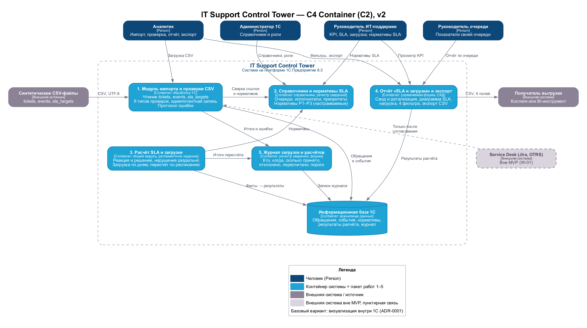

# IT Support Control Tower — команда 4

Учебный проект по кейсу № 19 «Дашборд производительности ИТ-подразделения» на платформе **1С:Предприятие 8.3**.

Система предназначена для анализа соблюдения SLA и распределения нагрузки внутренней ИТ-поддержки. Руководитель сможет находить проблемные очереди и исполнителей, сравнивать показатели и выгружать результаты на основе синтетических данных об обращениях.

Импорт, хранение, проверки, расчёты, отчёт и визуализация реализуются внутри 1С ([ADR-0001](docs/adr/ADR-0001-platform-1c-only.md)). Источник — локальные синтетические CSV-файлы. Система поддерживает управленческий анализ: решения о распределении работы принимает человек.

**Статус: проектирование завершено (практики 1–6).** Конфигурация 1С и MVP разрабатываются по [плану работ](docs/work-plan.md): веха M3 «Минимальная рабочая версия» — 15.12.26, защита MVP — 22.12.26. До появления конфигурации запуск системы из репозитория недоступен.

## Документация

| Практика | Документ | Содержание |
|---|---|---|
| 1 | [Карточка проекта](docs/project-card.md) | Паспорт, команда, KPI, границы |
| 1, 5, 6 | [Устав](docs/01-charter.md) | Цели, объём, бизнес-правила, контрольные точки, реестр рисков, реестр запросов на изменение, план коммуникаций |
| 1 | [Анализ рынка и аналогов](docs/market-analysis.md) | TAM/SAM/SOM, матрица конкурентов, инсайты |
| 2 | [Vision](docs/vision.md) | Vision Statement, границы, метрики успеха |
| 2, 6 | [Реестр требований (MoSCoW)](docs/02-requirements.md) | M-01 – M-14, S-, C-, W-, НФТ; открытые вопросы; методика расчёта; матрица трассируемости |
| 3 | [Акторы и Use Case](docs/use-cases.md) | Портрет пользователя, акторы, UC-01 – UC-32, полное описание UC-01 |
| 3 | [Пользовательские сценарии](docs/user-scenarios.md) | SC-01 – SC-12 |
| 4 | [C4 Context](docs/c4-context.md) | Системный контекст |
| 4–6 | [Архитектура](docs/03-architecture.md) | Обзор C4 и ADR-0001 – ADR-0003 |
| 5 | [C4 Container](docs/c4-container.md) | Контейнеры = пакеты работ |
| 5 | [Пакеты работ](docs/work-packages.md) | WBS, RACI, риски контейнеров, ЗИ, регламент по архитектуре |
| 5 | [Протокол совещания № 1](docs/meetings/2026-11-17-protocol-01.md) | Решения и поручения П-1 – П-5 |
| 6 | [C4 Component](docs/c4-component.md) | Компоненты модуля импорта |
| 6 | [План работ](docs/work-plan.md) | Задачи З-01 – З-36, критический путь, итерации, загрузка |
| 6 | [Журнал прогресса](docs/04-progress.md) | Контрольные точки, поручения, допущения, вопросы |
| 6 | [Данные: спецификация CSV и контрольный набор](data/sample/README.md) | Формат, проверки V1 – V6, ожидаемые значения |
| 6 | [Приёмочные проверки](tests/README.md) | T-01 – T-21 |
| — | [Шаблоны](docs/templates/) | [Задача трекера](docs/templates/task.md), [ADR](docs/templates/adr.md) |

## Архитектура (C4)

| Уровень | Схема |
|---|---|
| C1 Context | [c4_context.png](docs/images/c4_context.png) |
| C2 Container | [c4_container.png](docs/images/c4_container.png) (v2), [c4_container_v1.png](docs/images/c4_container_v1.png) (v1) |
| C3 Component | [c4_component.png](docs/images/c4_component.png) |



## Команда

| Роль | Участник |
|---|---|
| R1 Product / Project Lead + BA/SA | Ватлин Виталий Дмитриевич |
| R2 1С / Backend Developer | Торубаров Никита Александрович |
| R3 Full-stack / UI Developer | Миронова Валерия Алексеевна |
| R4 Data / Analytics Developer | Воробьёв Никита Сергеевич |

Роли, зоны ответственности, RACI и правила работы — [TEAM.md](TEAM.md).

## Структура репозитория

```text
docs/            документы проекта, ADR, протоколы, шаблоны
docs/diagrams/   исходники диаграмм C4
docs/images/     диаграммы C4 и Use Case
data/sample/     спецификация CSV, контрольный и негативный наборы
tests/           приёмочные проверки
```

## Лицензия

Условия использования указаны в файле [LICENSE](LICENSE).
