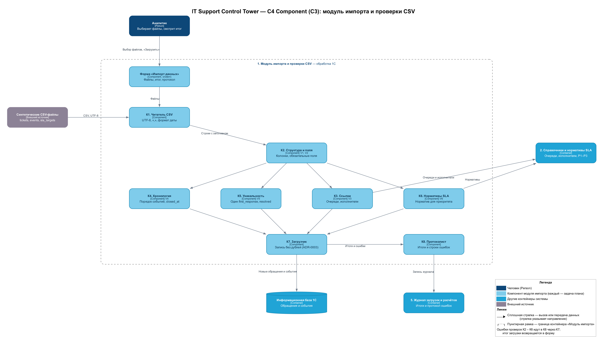

# C4 Component Diagram — IT Support Control Tower

| Поле | Описание |
|---|---|
| Документ | C4, уровень 3: компоненты контейнера «Модуль импорта и проверки CSV» (практика 6) |
| Версия | v1.0 |
| Дата | 17.11.26 |
| Основа | [c4-container.md](c4-container.md) v2.0, [work-packages.md](work-packages.md), [use-cases.md](use-cases.md), раздел 4 (UC-01), [ADR-0003](adr/ADR-0003-idempotent-import-key.md) |
| Автор | R2 (Торубаров Н. А.) |
| Исходник | [diagrams/c4_component.dot](diagrams/c4_component.dot) |

## 1. Почему раскрыт модуль импорта

- Самый трудоёмкий пакет: 30 ч из 115 по укрупнённой оценке ([work-packages.md](work-packages.md)).
- Через него проходят три Must (M-03, M-04, M-13) и все шесть проверок данных; ошибка здесь искажает все показатели дальше по цепочке.
- Начало критического пути: расчёт, отчёт и экспорт не проверить без загруженных данных.
- Модуль естественно делится на независимые компоненты-валидаторы, которые можно раздать разным исполнителям и тем самым снять перегрузку R2 (РК-8).

## 2. Диаграмма

**Легенда.** Цвета: тёмно-синий — человек; светло-голубые — компоненты модуля импорта; голубые — другие контейнеры системы; серый — внешний источник.
**Линии:** сплошная стрелка — вызов или передача данных, стрелка показывает направление; пунктирная рамка — граница контейнера «Модуль импорта и проверки CSV». Ошибки проверок К2 – К6 передаются в К8 через К7, итог загрузки возвращается в форму (отдельными стрелками не показано, чтобы линии не пересекались).

## 3. Компоненты

| Компонент | Ответственность | Вызывает | Требования | Задача |
|---|---|---|---|---|
| Форма «Импорт данных» | Выбор файлов, команда «Загрузить», итог загрузки, открытие протокола ошибок | К1, К8 | M-03, M-04 | З-12 |
| К1. Читатель CSV | Кодировка UTF-8, разделитель «,», строка заголовка, приведение даты-времени к `YYYY-MM-DD HH:MM:SS` | К2 | M-03 | З-03 |
| К2. Валидатор структуры и обязательных полей | V1 — есть все колонки (иначе файл не загружается); V2 — заполнены обязательные поля | К3 – К6, К8 | M-04 | З-04 |
| К3. Валидатор ссылок | V3 — очередь и исполнитель есть в справочниках, событие ссылается на обращение из файла или ИБ | Справочники, К8 | M-04 | З-05 |
| К4. Валидатор хронологии | V4 — `created_at ≤ first_response ≤ resolved`, `created_at ≤ closed_at` | К8 | M-04 | З-06 |
| К5. Валидатор уникальности событий | V5 — не больше одного `first_response` и `resolved` на обращение, включая уже загруженные | ИБ, К8 | M-04, M-13 | З-07 |
| К6. Проверка нормативов SLA | V6 — для приоритета обращения есть норматив реакции и решения | Нормативы SLA, К8 | M-04, M-06 | З-08 |
| К7. Загрузчик | Запись обращений без ошибок вместе с событиями; пропуск дублей по ключам ADR-0003 | ИБ, К8 | M-03, M-13 | З-11 |
| К8. Протоколист | Итоги (принято, пропущено, отклонено), строки ошибок: номер строки, `ticket_id`, правило | Журнал | M-04, M-12 | З-10 |

Регистры обращений и событий (З-02) и регистр журнала (З-09) — объекты хранения контейнеров ИБ и 5, на диаграмме показаны как контейнеры.

## 4. Связи

| Откуда | Куда | Что передаётся | Способ |
|---|---|---|---|
| Аналитик | Форма «Импорт данных» | Выбор файлов, команда «Загрузить» | Управляемая форма |
| Синтетические CSV-файлы | К1 | Файлы `tickets`, `events`, `sla_targets` | Чтение файла на сервере |
| К1 | К2 | Строки с именами колонок | Вызов внутри серверного модуля |
| К2 | К3 – К6 | Обращения с событиями, прошедшие V1 и V2 | Вызов |
| К3, К6 | Справочники и нормативы SLA | Запрос наличия очереди, исполнителя, норматива | Запрос |
| К3 – К6 | К7 | Обращения без ошибок | Вызов |
| К2 – К6 | К7 | Обращения с результатами проверок, включая ошибки | Вызов |
| К7 | ИБ | Новые обращения и события | Запись регистров в одной транзакции на обращение |
| К7 | К8 | Итоги записи и ошибки проверок | Вызов |
| К8 | Журнал загрузок и расчётов | Запись журнала | Запись регистра |
| К8 | Форма «Импорт данных» | Итог и протокол | Возврат результата |
