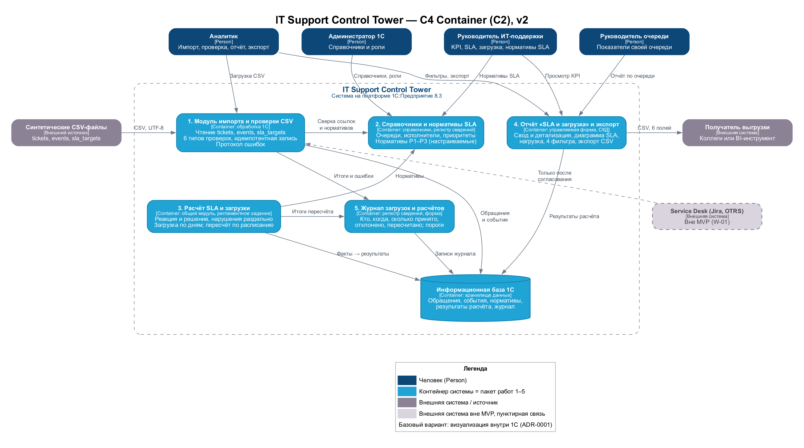

# C4 Container Diagram — IT Support Control Tower

| Поле | Описание |
|---|---|
| Документ | C4, уровень 2: контейнеры (практика 5) |
| Версия | v2.0 |
| Дата | 17.11.26 |
| Основа | Схема C2 R2 из ветки `backend` ([c4_container_v1.png](images/c4_container_v1.png)), [c4-context.md](c4-context.md), [use-cases.md](use-cases.md), [MoSCoW](02-requirements.md) |
| Автор | R2 (Торубаров Н. А.) |
| Исходник | [diagrams/c4_container.dot](diagrams/c4_container.dot) |

**История версий:**

| Версия | Что | Почему |
|---|---|---|
| v1.0 (R2) | Три контейнера: «Клиентский интерфейс 1С», «Серверная логика 1С», «Информационная база 1С»; внешние «Синтетические CSV-файлы» и «Service Desk» (вне MVP, пунктир) | Первая версия архитектуры |
| v2.0 | «Серверная логика 1С» и клиентский интерфейс разложены на пять функциональных контейнеров (подсистем 1С); ИБ сохранена; добавлены роли из Context v2 и получатель выгрузки | ЗИ-01: по практике 5 каждый контейнер — пакет работ; в v1.0 «Серверная логика» была бы одним пакетом на ~60 % объёма без распределения владельцев. Решение протокола № 1 |

## 1. Диаграмма v2

**Легенда:** тёмно-синие — люди; голубые — контейнеры системы (пакеты работ 1–5) и ИБ; серые — внешние системы; светло-серый с пунктиром — вне MVP. Пунктирная рамка — граница системы на 1С:Предприятие 8.3.

Исходная схема v1.0: [c4_container_v1.png](images/c4_container_v1.png).

## 2. Контейнеры

Все контейнеры — подсистемы одной конфигурации 1С:Предприятие 8.3 ([ADR-0001](adr/ADR-0001-platform-1c-only.md)). «Контейнер» здесь — функционально самостоятельная часть конфигурации со своим владельцем и пакетом работ.

| № | Контейнер / пакет работ | Технология 1С | Ответственность | Use Case | Требования | MoSCoW |
|---|---|---|---|---|---|---|
| 1 | Модуль импорта и проверки CSV | Обработка, серверный общий модуль, управляемая форма | Чтение `tickets`, `events`, `sla_targets`; 6 типов проверок (V1 – V6); идемпотентная запись; протокол ошибок | UC-01 – UC-03, UC-05 | M-03, M-04, M-13 | Must |
| 2 | Справочники и нормативы SLA | Справочники «Очереди», «Исполнители», «Приоритеты»; регистр сведений «Нормативы SLA» | Ссылочные данные; нормативы P1 – P3, настраиваемые с проверкой полноты | UC-04, UC-20, UC-21 | M-06 (нормативы), M-04 (ссылки) | Must |
| 3 | Расчёт SLA и загрузки | Общий модуль, регистры сведений с результатами, регламентное задание | Реакция и решение, нарушения раздельно, загрузка по дням; пересчёт по расписанию или по команде ([ADR-0002](adr/ADR-0002-calculation-separate-from-report.md)) | UC-11 | M-05, M-06, M-07, M-13 | Must |
| 4 | Отчёт «SLA и загрузка» и экспорт | Управляемая форма, система компоновки данных (СКД), диаграммы | Свод и детализация, диаграмма SLA по приоритетам, нагрузка, 4 фильтра, отметка актуальности (ЗИ-03), экспорт CSV `queue,priority,resp_avg,resolve_avg,breach_rate,load_avg` | UC-10, UC-12 – UC-14, UC-17, UC-18, UC-22 | M-08, M-09, M-10, M-11 (резерв: S-01 – S-03) | Must |
| 5 | Журнал загрузок и расчётов | Регистр сведений, форма списка | Кто, когда, сколько принято, отклонено, пересчитано; пороги SLA на момент расчёта | UC-03, UC-23, UC-24 | M-04 (протокол), M-12, M-13 | Must |
| — | Информационная база 1С | Файловая ИБ | Хранение обращений, событий, нормативов, результатов расчёта и журнала. Отдельным пакетом не является: работы по ней входят в пакеты 1, 2, 3 и 5 | все | M-01 | — |

Сквозные работы (роли, синтетический набор, проверки, архитектура, документация) контейнером не являются и собраны в пакет 6 ([work-packages.md](work-packages.md)).

## 3. Связи

| Откуда | Куда | Что передаётся | Формат / способ |
|---|---|---|---|
| Синтетические CSV-файлы | 1. Импорт | Обращения, события, нормативы | CSV, UTF-8, разделитель «,» ([спецификация](../data/sample/README.md)) |
| Аналитик | 1. Импорт; 4. Отчёт | Файлы для загрузки; фильтры, команда экспорта | Управляемые формы |
| Руководитель ИТ-поддержки | 2. Нормативы; 4. Отчёт | Нормативы SLA; просмотр KPI | Управляемые формы |
| Руководитель очереди | 4. Отчёт | Отчёт по своей очереди | Управляемая форма |
| Администратор 1С | 2. Справочники | Очереди, исполнители, роли | Формы справочников |
| 1. Импорт | 2. Справочники | Сверка ссылок и наличия нормативов | Вызов серверного модуля |
| 1. Импорт | ИБ | Новые обращения и события; дубли пропускаются | Запись регистров |
| 1. Импорт | 5. Журнал | Итоги загрузки, строки ошибок | Запись регистра |
| 3. Расчёт | ИБ | Чтение фактов, запись результатов | Запросы, запись регистров |
| 3. Расчёт | 2. Нормативы | Действующие нормативы SLA | Запрос |
| 3. Расчёт | 5. Журнал | Итоги пересчёта, время расчёта | Запись регистра |
| 4. Отчёт | ИБ | Готовые результаты расчёта | Запрос СКД |
| 4. Отчёт | Получатель выгрузки | Агрегированные показатели | CSV, 6 полей |
| Service Desk | 1. Импорт | Будущий источник данных | Вне MVP, только после согласования |

## 4. Почему не три контейнера

Если R2 при подтверждении протокола решит вернуться к трём контейнерам v1.0, пакеты работ 1–5 остаются подсистемами внутри «Серверной логики 1С», а этот документ сохраняет таблицу из раздела 2 как разбиение на подсистемы. Владельцы, оценки и задачи при этом не меняются.
