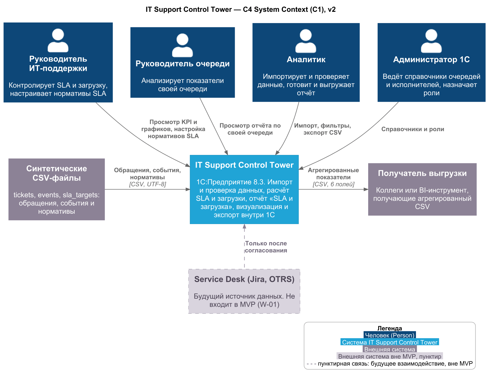
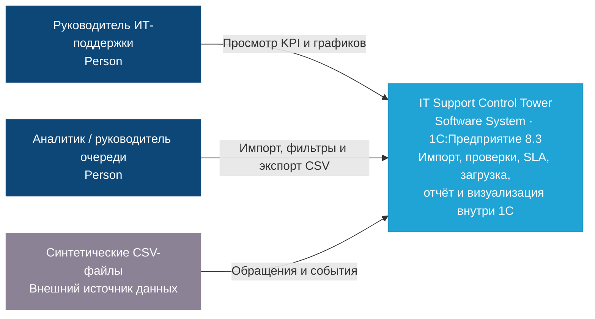

# C4 Context Diagram — IT Support Control Tower

| Поле | Описание |
|---|---|
| Документ | C4, уровень 1: системный контекст (практика 4) |
| Версия | v2.0 |
| Дата | 17.11.26 |
| Основа | Схема C1 из README (R2), [акторы и Use Case](use-cases.md), [Vision](vision.md) |
| Автор | R2 (Торубаров Н. А.), R3 (Миронова В. А.) |
| Исходник | [diagrams/c4_context.puml](diagrams/c4_context.puml) (PlantUML C4) |

**История версий:** v1.0 — схема R2 в README (mermaid): два блока людей, источник CSV, система. v2.0 — изменения по запросу ЗИ-02 (автор R3): добавлен Администратор 1С, «Аналитик / руководитель очереди» разделён на два актора, как в Use Case; показаны получатель выгрузки и Service Desk вне MVP. Исходная схема v1.0 сохранена в разделе 4.

## 1. Диаграмма

**Легенда:** тёмно-синие — люди; синий — система; серые — внешние системы; светло-серый с пунктиром — внешняя система вне MVP, пунктирная стрелка — будущее взаимодействие.

## 2. Элементы диаграммы

| Элемент | Тип | Роль | Связь с системой | Use Case / требования |
|---|---|---|---|---|
| Руководитель ИТ-поддержки | Человек | Основной пользователь | Просмотр KPI и графиков, настройка нормативов SLA | UC-10, UC-20; M-06, M-08 |
| Руководитель очереди | Человек | Дополнительный пользователь | Просмотр отчёта по своей очереди | UC-10; M-09 |
| Аналитик | Человек | Дополнительный пользователь | Импорт, фильтры, экспорт CSV | UC-01, UC-22, UC-24; M-03, M-11 |
| Администратор 1С | Человек | Служебная роль | Справочники и роли | UC-04, UC-25; M-14 |
| IT Support Control Tower | Система | Разрабатываемая система на 1С:Предприятие 8.3 | — | M-01 |
| Синтетические CSV-файлы | Внешняя система | Источник данных | Обращения, события, нормативы; CSV, UTF-8 | UC-01; M-02, M-03 |
| Получатель выгрузки | Внешняя система | Потребитель результата | Агрегированный CSV из 6 полей | UC-22; M-11 |
| Service Desk (Jira, OTRS) | Внешняя система вне MVP | Будущий источник | Только после согласования | W-01 |

## 3. Что осознанно не показано

| Что | Почему |
|---|---|
| Внутреннее устройство системы (модули, ИБ) | Уровень C2: [c4-container.md](c4-container.md) |
| Оператор 1-й и 2-й линии | Ввод событий вручную (SC-12) — Could, вне MVP; события приходят из CSV |
| Специалист ИТ-поддержки | В MVP не работает с системой напрямую; видит отчёт через руководителя |
| Отдельное аналитическое приложение на CSV-снимке | Альтернатива ADR-0001, допустима только после согласования с преподавателем |
| Генератор синтетических данных | Инструмент команды (задача З-16), а не часть продукта |

## 4. Исходная схема v1.0 (R2)

