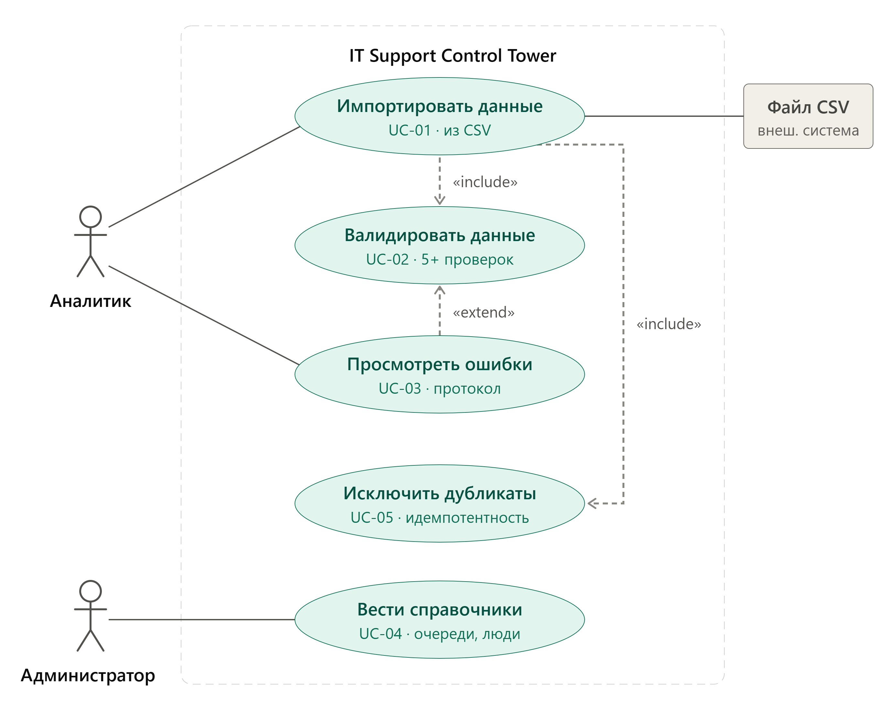
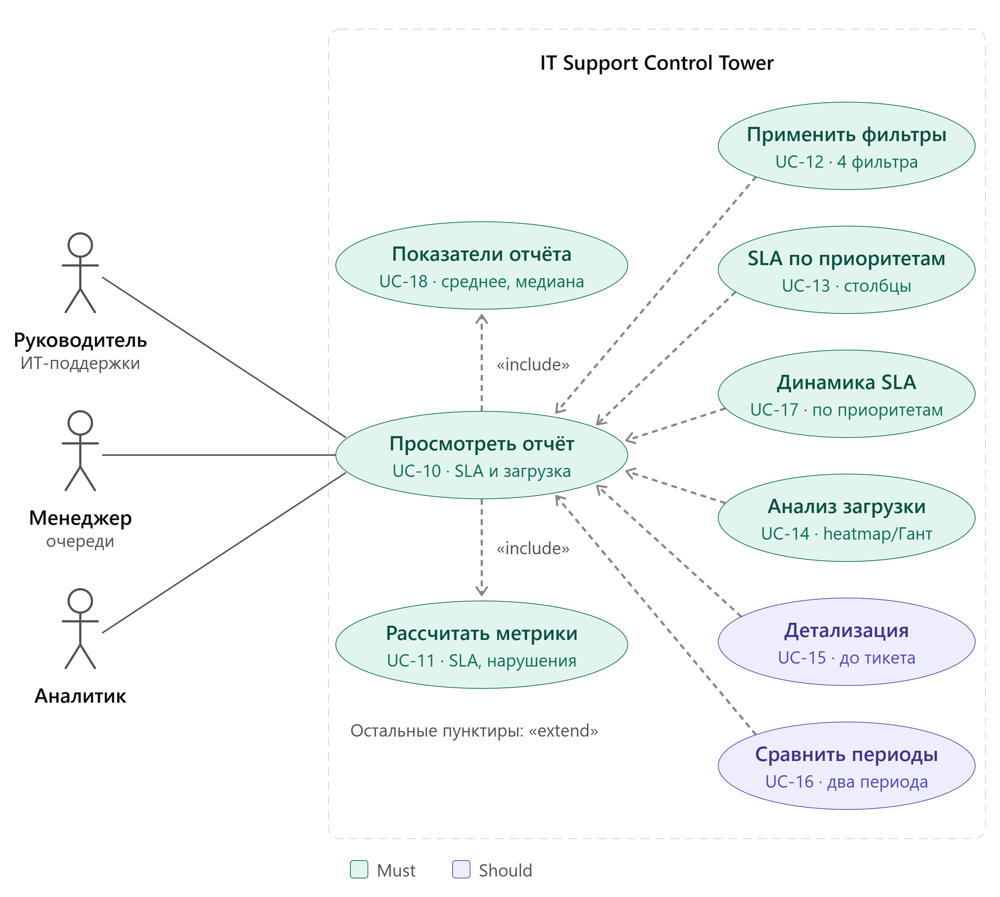
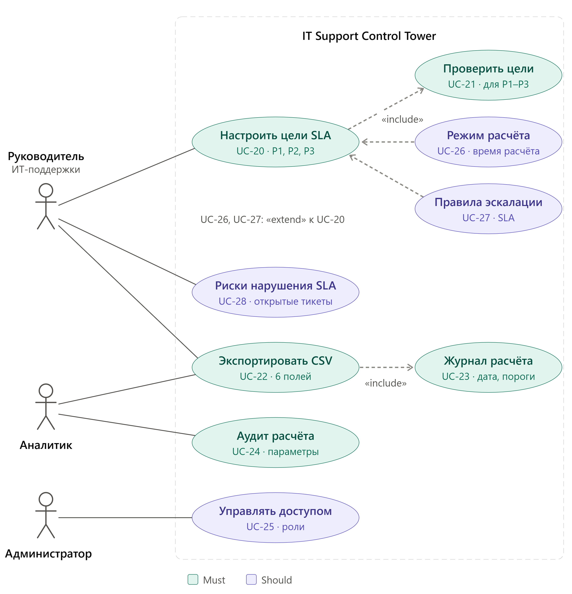

# Акторы и Use Case — IT Support Control Tower

| Поле | Описание |
|---|---|
| Документ | Портрет пользователя, реестр акторов и внешних систем, перечень и описание Use Case (практика 3) |
| Версия | v1.0 |
| Дата | 17.11.26 |
| Основа | Диаграммы Use Case R3 ([1](images/use_case_1_data_import_validation.png), [2](images/use_case_2_sla_load_analysis.png), [3](images/use_case_3_sla_settings_export_traceability.png)), [сценарии SC-01 – SC-12](user-scenarios.md), [карточка](project-card.md), [Vision](vision.md), [MoSCoW](02-requirements.md) |
| Автор | R3 (Миронова В. А.) |

## 1. Портрет пользователя

Отдельного портрета в материалах команды не было; раздел составлен по карточке (раздел 6) и Vision (раздел «Целевые пользователи»).

| Поле | Основной пользователь: руководитель ИТ-поддержки |
|---|---|
| Кто | Руководитель внутренней ИТ-поддержки с первой и второй линиями, несколькими очередями и исполнителями |
| Задачи | Контролировать соблюдение SLA по приоритетам, находить проблемные очереди и перегруженных исполнителей, готовить управленческий отчёт |
| Боли | Показатели считаются вручную или разрозненно; трудно сравнивать срезы; непонятно, по какой формуле получена цифра |
| Что ценит | Один отчёт с фильтрами; прозрачные формулы; уверенность, что данные проверены |
| Чего не ждёт от системы | Автоматического переназначения обращений и кадровых решений (W-02, W-05): решение принимает человек |
| Как измеряем успех | Метрики раздела «Измеримые метрики успеха» в [vision.md](vision.md) |

Дополнительные пользователи: руководитель очереди (только свою очередь), аналитик (загрузка и проверка данных, экспорт), администратор 1С (справочники и роли).

## 2. Реестр акторов и внешних систем

| Код | Актор | Тип | Описание | Use Case |
|---|---|---|---|---|
| A1 | **Руководитель ИТ-поддержки** | Основной, человек | Смотрит отчёт и KPI, настраивает нормативы SLA | UC-10, UC-20, UC-22, UC-28 |
| A2 | **Руководитель очереди** (на диаграмме — «Менеджер очереди») | Основной, человек | Смотрит отчёт по своей очереди | UC-10 |
| A3 | **Аналитик** | Основной, человек | Импортирует и проверяет данные, готовит и выгружает отчёт, проверяет параметры расчёта | UC-01, UC-03, UC-10, UC-22, UC-24 |
| A4 | **Администратор 1С** | Основной, человек | Ведёт справочники очередей и исполнителей, назначает роли | UC-04, UC-25 |
| A5 | Оператор 1-й и 2-й линии | Человек, вне MVP | Вводит события обращения вручную (SC-12, Could) | UC-30 – UC-32 |
| A6 | Планировщик 1С (регламентное задание) | Вспомогательный, системный | Запускает пересчёт метрик по расписанию ([ADR-0002](adr/ADR-0002-calculation-separate-from-report.md)) | UC-11 |
| E1 | **Синтетические CSV-файлы** | Внешняя система | Источник `tickets`, `events`, `sla_targets` | UC-01 |
| E2 | Получатель выгрузки | Внешняя система | Коллеги или BI-инструмент, получающие CSV | UC-22 |
| E3 | Service Desk (Jira, OTRS) | Внешняя система, вне MVP | Возможный будущий источник (W-01) | — |

## 3. Перечень Use Case

Коды и приоритеты взяты с диаграмм R3. Номера UC-06 – UC-09, UC-19, UC-29 на диаграммах не используются (резерв нумерации R3).

| Код | Use Case | Основной актор | Связь | Требования | Приоритет |
|---|---|---|---|---|---|
| UC-01 | Импортировать данные из CSV | Аналитик | — | M-03 | Must |
| UC-02 | Валидировать данные (5+ проверок) | — | «include» из UC-01 | M-04 | Must |
| UC-03 | Просмотреть ошибки (протокол) | Аналитик | «extend» к UC-02 | M-04 | Must |
| UC-04 | Вести справочники (очереди, исполнители) | Администратор 1С | — | M-04, M-14 | Must |
| UC-05 | Исключить дубликаты (идемпотентность) | — | «include» из UC-01 | M-13 | Must |
| UC-10 | Просмотреть отчёт «SLA и загрузка» | Руководитель ИТ-поддержки, руководитель очереди, аналитик | — | M-08 | Must |
| UC-11 | Рассчитать метрики (SLA, нарушения) | Планировщик 1С | «include» из UC-10 | M-05, M-06, M-07 | Must |
| UC-12 | Применить фильтры (4 фильтра) | — | «extend» к UC-10 | M-09 | Must |
| UC-13 | SLA по приоритетам (столбцы) | — | «extend» к UC-10 | M-06, M-10 | Must |
| UC-14 | Анализ загрузки (heatmap / Гант) | — | «extend» к UC-10 | M-07, M-10 | Must |
| UC-15 | Детализация до обращения | — | «extend» к UC-10 | S-02 | Should |
| UC-16 | Сравнить два периода | — | «extend» к UC-10 | C-02 | Should |
| UC-17 | Динамика SLA по приоритетам | — | «extend» к UC-10 | M-10, C-02 | Must (см. раздел 6, вопрос 1) |
| UC-18 | Показатели отчёта: среднее, медиана | — | «include» из UC-10 | M-08, S-01 | Must |
| UC-20 | Настроить цели SLA для P1, P2, P3 | Руководитель ИТ-поддержки | — | M-06, M-14 | Must |
| UC-21 | Проверить цели для P1 – P3 | — | «include» из UC-20 | M-06 | Must |
| UC-22 | Экспортировать CSV (6 полей) | Аналитик, руководитель ИТ-поддержки | — | M-11 | Must |
| UC-23 | Журнал расчёта: дата, пороги | — | «include» из UC-22 | M-11, M-12 | Must |
| UC-24 | Аудит расчёта (параметры) | Аналитик | — | M-12 | Must |
| UC-25 | Управлять доступом (роли) | Администратор 1С | — | M-14 (база), остальное Should | Should |
| UC-26 | Режим расчёта (календарное / рабочее время) | — | «extend» к UC-20 | ОВ-1 | Should |
| UC-27 | Правила эскалации SLA | — | «extend» к UC-20 | — | Should |
| UC-28 | Риски нарушения SLA (открытые обращения) | Руководитель ИТ-поддержки | — | — | Should |
| UC-30 – UC-32 | Зарегистрировать события обращения | Оператор 1-й и 2-й линии | — | — | Could, вне плана |

Диаграммы:

## 4. Описание UC-01 «Импортировать и проверить данные обращений из CSV»

Описание объединяет UC-01, включённые UC-02 и UC-05 и расширение UC-03. Основа — сценарии SC-01, SC-02, SC-03; компоненты — [c4-component.md](c4-component.md).

| Поле | Описание |
|---|---|
| Код | UC-01 (+ UC-02, UC-03, UC-05) |
| Основной актор | Аналитик |
| Второстепенные акторы | Синтетические CSV-файлы (E1) |
| Цель | Получить в системе проверенные обращения и события для расчёта SLA и загрузки |
| Уровень и приоритет | Пользовательская цель; Must |
| Предусловия | 1. У пользователя роль «Аналитик» (M-14). 2. Справочники очередей и исполнителей заполнены (UC-04). 3. Нормативы SLA заданы для P1, P2, P3 (UC-20). 4. Есть файлы `tickets.csv`, `events.csv`, при необходимости `sla_targets.csv` в формате [спецификации](../data/sample/README.md) |
| Триггер | Нужно построить отчёт за новый период или загрузить исправленные данные |
| Основной поток | 1. Аналитик открывает форму «Импорт данных». 2. Выбирает файлы `tickets`, `events`, `sla_targets`. 3. Нажимает «Загрузить». 4. Система читает файлы (UTF-8, разделитель «,», строка заголовка) и проверяет структуру и обязательные поля (V1, V2). 5. Для каждого обращения система проверяет ссылки на очередь и исполнителя (V3), хронологию `created_at ≤ first_response ≤ resolved` и `created_at ≤ closed_at` (V4), уникальность `first_response` и `resolved` (V5), наличие норматива SLA для приоритета (V6). 6. Система записывает обращения без ошибок; совпадающие по ключам ([ADR-0003](adr/ADR-0003-idempotent-import-key.md)) пропускает как дубликаты (UC-05). 7. Система записывает итог в журнал: принято, пропущено, отклонено. 8. Система показывает итог загрузки |
| Альтернативные потоки | **4а.** Файл не CSV или нет обязательной колонки: система сообщает, какой колонки нет, и ничего не загружает (SC-01, 2а). **5а.** У обращения есть ошибки: обращение отклоняется целиком вместе с событиями, остальные загружаются; на итоговом экране кнопка «Открыть протокол ошибок» (UC-03). **5б.** Аналитик открывает протокол: строки с номером, `ticket_id` и нарушенным правилом, фильтр по правилу; ошибок нет — сообщение «Ошибок не найдено» (SC-02). **6а.** Повторная загрузка того же файла: все обращения и события пропущены как дубликаты, показатели не меняются (SC-03) |
| Постусловия | Успех: корректные обращения и события в ИБ, запись в журнале, данные готовы к пересчёту (UC-11). Неуспех: ИБ не изменилась, причина видна в протоколе |
| Бизнес-правила | Проверки V1 – V6 и правила частичной загрузки — [data/sample/README.md](../data/sample/README.md), раздел 4; решение ОВ-6 в [02-requirements.md](02-requirements.md) |
| Требования | M-03, M-04, M-13 |
| Проверки | T-01 – T-09 ([tests/README.md](../tests/README.md)) |

## 5. Трассировка: Must → Use Case

| Требование | Use Case | Сценарий |
|---|---|---|
| M-01 Платформа 1С | Все UC | — |
| M-02 Набор ≥ 300 обращений | UC-01 | SC-01 |
| M-03 Импорт CSV | UC-01 | SC-01 |
| M-04 Проверки данных | UC-02, UC-03, UC-04 | SC-01, SC-02, SC-11 |
| M-05 Реакция и решение | UC-11, UC-18 | SC-04 |
| M-06 Нарушения SLA по приоритетам | UC-11, UC-13, UC-20, UC-21 | SC-04, SC-09 |
| M-07 Нагрузка | UC-11, UC-14 | SC-05 |
| M-08 Отчёт «SLA и загрузка» | UC-10, UC-18 | SC-04 |
| M-09 Фильтры | UC-12 | SC-04, SC-05 |
| M-10 Визуализация | UC-13, UC-14, UC-17 | SC-04, SC-05, SC-06 |
| M-11 Экспорт CSV | UC-22, UC-23 | SC-07 |
| M-12 Документация и контрольные примеры | UC-23, UC-24 | SC-08 |
| M-13 Повторяемость | UC-05 | SC-03 |
| M-14 Роли доступа | UC-04, UC-20, UC-25 (база) | SC-09, SC-11 |

## 6. Расхождения с другими документами

| № | Расхождение | Как записано | Где решается |
|---|---|---|---|
| 1 | UC-17 «Динамика SLA» на диаграмме Must, а в MoSCoW расширенная визуализация динамики — C-02 | Для MVP достаточно диаграммы SLA по приоритетам за период (M-10); динамика по дням — резерв (C-02) | Решено командой 17.11.26, [04-progress.md](04-progress.md), раздел 6 |
| 2 | UC-18 включает медиану (S-01, Should) в Must-сценарий | Только среднее, медиана в план MVP не входит | То же |
| 3 | UC-25 «Управлять доступом» — Should, но без базовых ролей не проверить SC-09 и SC-11 | Базовые роли добавлены как M-14 (ЗИ-05) | [01-charter.md](01-charter.md), приложение Б |
